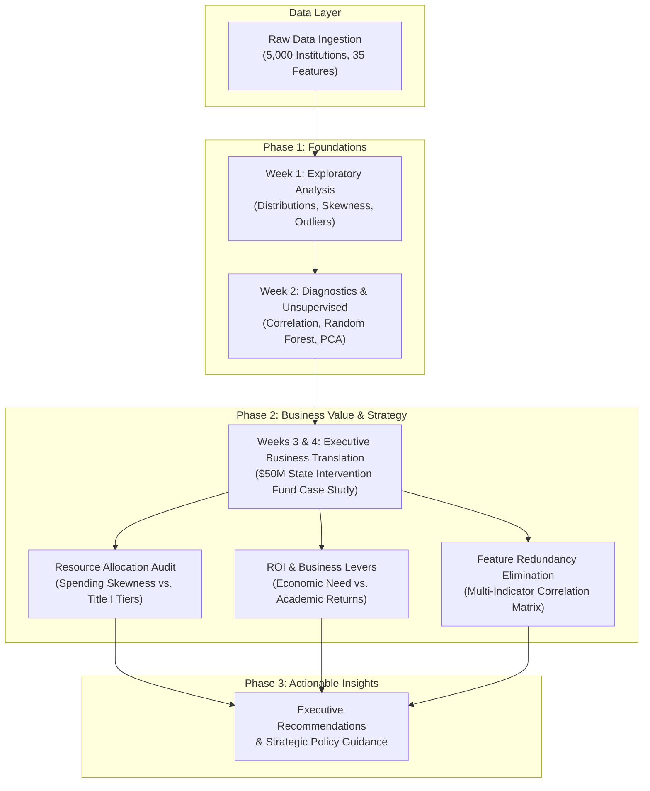

# AltSchool Africa — 3rd Semester Machine Learning & Data Science Portfolio

[](https://www.python.org/)
[](https://jupyter.org/)
[](https://scikit-learn.org/)
[](https://pandas.pydata.org/)
[](https://seaborn.pydata.org/)
[]()
[](LICENSE)

> **Tracking Machine Learning Workflows, Business-Centric Visualizations, Statistical Modeling, Diagnostic Evaluations, and Portfolio Deliverables for AltSchool Africa (3rd Semester — 2026).**

---

> [!IMPORTANT]
> ### ⚠️ Mandatory Educational Disclaimer & Caveat
> **The dataset and statistical analyses in this repository are compiled strictly for educational, pedagogical, and coursework purposes within the AltSchool Africa Data Science & Machine Learning track.**  
> The underlying data is synthetic/simulated and **is NOT a reflection of the actual United States educational system**, the National Center for Education Statistics (NCES), or any specific academic institution. Any resemblance to real institutions, living persons, or actual federal records is purely coincidental.

---

## 📌 Portfolio Overview

This repository documents the applied machine learning engineering, exploratory analysis, and business translation coursework for the **3rd Semester of the AltSchool Africa Data Science / Machine Learning Program**.

The core objective is to move beyond "black-box" modeling and superficial charting to establish a rigorous, production-grade analytical pipeline. The portfolio demonstrates how exploratory visualization, diagnostic model auditing, and dimensional reduction directly inform high-stakes decision-making and executive resource allocation.



---

## 📅 Semester Curriculum & Activity Tracker

| Week / Module | Focus Area & Key Topics | Status | Main Deliverables & Notebooks |
| :--- | :--- | :---: | :--- |
| **Week 1** | **ML Visualization & Exploratory Data Analysis (EDA)**<br>• Visualization Pipeline Setup (Matplotlib, Seaborn)<br>• Univariate & Multivariate Distribution Analysis<br>• Socioeconomic & Academic Feature Interaction | `COMPLETED` | [`third_Semester_Wk1.ipynb`](third_Semester_Wk1.ipynb)<br>[`us_education_system_dataset.csv`](us_education_system_dataset.csv) |
| **Week 2** | **Feature Correlation, Model Diagnostics & Dimensionality Reduction**<br>• Multi-Feature Pearson Correlation Heatmaps<br>• Supervised Classification Baseline (Random Forest Classifier)<br>• Diagnostic Confusion Matrix Heatmap Evaluation<br>• Unsupervised PCA (2D Variance Projection) | `COMPLETED` | [`third_Semester_Week1_and_week_2.ipynb`](third_Semester_Week1_and_week_2.ipynb) |
| **Weeks 3 & 4** | **Business Value of Data Visualization for Machine Learning**<br>• *"Why Business Leaders Don't Buy Black Boxes"*<br>• $50 Million Intervention Fund Allocation Case Study<br>• Resource Allocation Audit & Skewness Analysis<br>• Discovering Business Levers (Socioeconomic Need vs. Academic ROI)<br>• Feature Redundancy Elimination via Correlation Matrices | `COMPLETED` | [`wk3_and_wk4_semester_3_BUSINESS_VALUE_OF_DATA_VISUALIZATION_FOR_ML.ipynb`](wk3_and_wk4_semester_3_BUSINESS_VALUE_OF_DATA_VISUALIZATION_FOR_ML.ipynb) |
| **Week 5** | **End-to-End ML Pipeline Packaging & Capstone Project**<br>• Production Pipeline Serialization & Model Serving Interface | `PLANNED` | *Upcoming* |

---

## 🔬 In-Depth Activity Highlights

### 📍 Week 1: Exploratory Data Analysis & Visualization Pipeline
* **Univariate Distribution & Skewness**:
  * Evaluated per-pupil expenditures (`per_pupil_expenditure_usd`) using Kernel Density Estimation (KDE) and histograms to identify skewness and funding variance across school counts.
  * Assessed math proficiency splits across federal Title I designations (`title_i_status`) using box plots to evaluate baseline disparities.
* **Multivariate Socioeconomic Mapping**:
  * Implemented multi-variable scatter plots mapping student socioeconomic needs (`percent_free_reduced_lunch`) against academic output (`math_proficiency_pct`), hue-encoded by institutional governance (`control`: Public, Charter, Private) and scaled by per-pupil spending.

### 📍 Week 2: Statistical Correlation, Supervised Diagnostics & PCA
* **Intercorrelation & Heatmap Analysis**:
  * Formatted a continuous numeric subset across 9 key indicators:
    `per_pupil_expenditure_usd`, `student_teacher_ratio`, `percent_free_reduced_lunch`, `special_education_pct`, `english_learner_pct`, `math_proficiency_pct`, `reading_proficiency_pct`, `graduation_rate_pct`, `chronic_absenteeism_pct`.
  * Computed Pearson correlation matrices and rendered publication-quality annotated heatmaps via Seaborn (`cmap='Blues'`) to inspect collinearity and identify primary drivers of academic performance.
* **Supervised Machine Learning Diagnostic**:
  * Formulated a binary target $y \in \{0, 1\}$ classifying academic achievement tiers based on the median math proficiency benchmark ($y = 1$ if $\text{math\_proficiency\_pct} \ge \text{median}$, else $0$).
  * Split feature matrix $X$ (with target dropped) and $y$ into training and hold-out test sets ($70\% / 30\%$, `random_state=42`).
  * Trained a `RandomForestClassifier(n_estimators=100, random_state=42)`.
  * Generated and visualized diagnostic confusion matrix heatmaps to assess true positives, false positives, sensitivity, and specificity across performance tiers.
* **Unsupervised Learning & Dimensionality Reduction**:
  * Standardized the multidimensional feature space using Scikit-Learn's `StandardScaler`.
  * Fitted Principal Component Analysis (`PCA(n_components=2)`) to project the high-dimensional institutional attributes onto 2 orthogonal principal axes.
  * Visualized 2D PCA embeddings with color-coded performance tiers, annotating explained variance ratios for both components.

### 📍 Weeks 3 & 4: Business Value of Data Visualization for Machine Learning
* **Executive Framing — "Why Business Leaders Don't Buy Black Boxes"**:
  * Addressed why high statistical accuracy alone (e.g., 95% accuracy) fails to impress executive stakeholders when models lack clarity, auditability, and actionable business levers.
  * Positioned data visualization as the essential **translation layer** bridging technical algorithms and strategic policy.
* **Real-World Case Study — $50 Million Intervention Fund Allocation**:
  * Advised a state Department of Education tasked with strategically deploying a $50M capital fund to improve student math proficiency.
* **Resource Allocation Audit**:
  * Conducted an institutional expenditure distribution audit revealing financial spending skewness.
  * Benchmarked academic performance across Title I funding tiers (`title_i_status`) to highlight systemic baselines.
* **Discovering Business Levers & ROI**:
  * Tackled the executive question: *"Does throwing money at schools solve performance gaps, or are socioeconomic factors stronger drivers?"*
  * Developed multi-layered scatter visualizations mapping economic hardship (`percent_free_reduced_lunch`), math outcomes (`math_proficiency_pct`), school governance models (`control`), and per-pupil spending levels (`per_pupil_expenditure_usd`).
* **Feature Redundancy Elimination**:
  * Analyzed key indicators (`per_pupil_expenditure_usd`, `student_teacher_ratio`, `percent_free_reduced_lunch`, `special_education_pct`, `english_learner_pct`, `math_proficiency_pct`, `reading_proficiency_pct`, `graduation_rate_pct`, `broadband_access_pct`).
  * Constructed correlation heatmaps using diverging color ramps (`coolwarm`) to identify non-redundant predictive variables for data-driven capital allocation.

---

## 📖 Feature Taxonomy & Dataset Architecture

The underlying dataset contains **5,000 observations across 35 features** organized into 8 functional domains:

1. **Institutional Identity & Geography**: `institution_id` (Primary Key), `institution_name`, `state_code`, `state_name`, `county`, `nces_locale` (8 locale categories).
2. **Governance & Classification**: `level` (Elementary, Middle, High, University, College), `control` (Public, Charter, Private), `title_i_status`.
3. **Staffing & Capacity**: `total_enrollment` (Min: 80, Max: 45,252), `number_of_teachers`, `student_teacher_ratio` (Mean: 14.93).
4. **Demographics & Socioeconomics**: `percent_free_reduced_lunch`, racial composition percentages (`racial_white_pct`, `racial_black_pct`, etc.), `special_education_pct`, `english_learner_pct`.
5. **Funding Architecture**: `per_pupil_expenditure_usd`, `federal_funding_pct`, `state_funding_pct`, `local_funding_pct` (Compositional Simplex: $\sum \text{funding} \equiv 100\%$).
6. **Academic Performance**: `math_proficiency_pct`, `reading_proficiency_pct`, `graduation_rate_pct`, `chronic_absenteeism_pct`.
7. **College Readiness (Structural MNAR)**: `avg_sat_score`, `avg_act_score`, `ap_ib_participation_pct`, `postsecondary_enrollment_pct` (populated only for secondary and higher institutions).
8. **Infrastructure & Accreditations**: `stem_certified_flag` (`Yes`/`No`), `broadband_access_pct` (Mean: 90.79%).

---

## 📁 Repository Directory Structure

```
Third_semester_Baraka_Altschool_2026/
├── README.md                                                                # Professional portfolio overview & curriculum tracker
├── third_Semester_Wk1.ipynb                                                 # Week 1 EDA & Visualization Pipeline Notebook
├── third_Semester_Week1_and_week_2.ipynb                                    # Week 1 & 2 Notebook (Correlation, RF Model, Confusion Matrix, PCA)
├── wk3_and_wk4_semester_3_BUSINESS_VALUE_OF_DATA_VISUALIZATION_FOR_ML.ipynb # Weeks 3 & 4 Business Value & $50M Allocation Case Study
└── us_education_system_dataset.csv                                          # Educational dataset (5,000 records, 35 features)
```

---

## 🛠️ Tech Stack & Requirements

* **Programming Language**: Python 3.8+
* **Development Environments**: Jupyter Notebook, VS Code, Google Colab
* **Data Processing**: `pandas`, `numpy`
* **Data Visualization**: `matplotlib`, `seaborn`
* **Machine Learning**: `scikit-learn` (`RandomForestClassifier`, `StandardScaler`, `PCA`, `confusion_matrix`, `train_test_split`)

---

## 🚀 Getting Started & Execution

### 1. Clone the Repository
```bash
git clone https://github.com/Ecoplex82/Third_semester_Baraka_Altschool_2026.git
cd Third_semester_Baraka_Altschool_2026
```

### 2. Set Up Virtual Environment & Dependencies
```bash
python -m venv venv
# On Windows:
venv\Scripts\activate
# On macOS/Linux:
source venv/bin/activate

pip install pandas numpy matplotlib seaborn scikit-learn jupyter
```

### 3. Launch Notebooks
```bash
# To run Weeks 3 & 4 Business Value Case Study:
jupyter notebook wk3_and_wk4_semester_3_BUSINESS_VALUE_OF_DATA_VISUALIZATION_FOR_ML.ipynb

# To run Weeks 1 & 2 Diagnostics Pipeline:
jupyter notebook third_Semester_Week1_and_week_2.ipynb
```

---

## 👤 Author & Acknowledgments

* **Author**: Emmanuel Bright Chetachi ([@Ecoplex82](https://github.com/Ecoplex82))
* **Program**: AltSchool Africa — Data Science & Machine Learning (3rd Semester)
* **Cohort Year**: 2026
