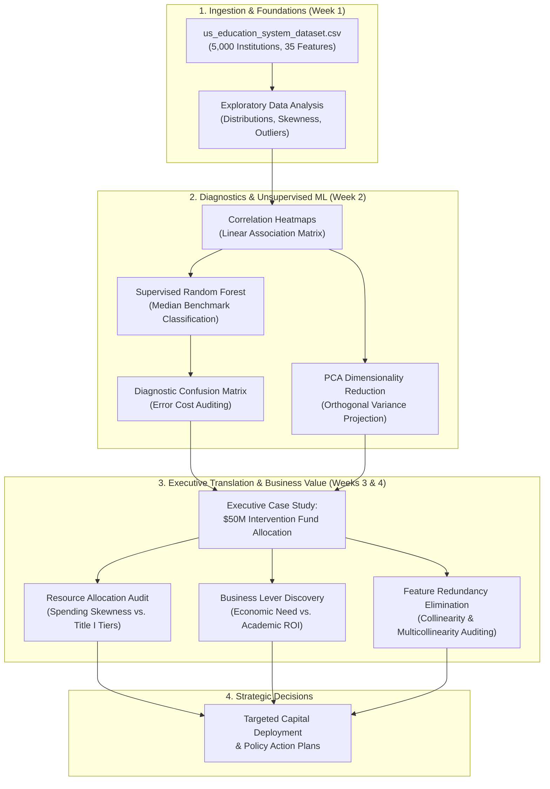
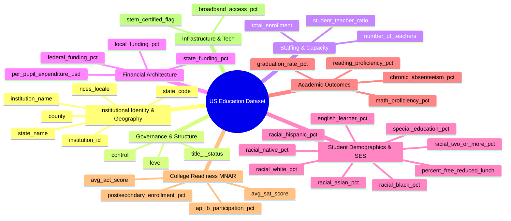

# AltSchool Africa — 3rd Semester Machine Learning & Data Science Portfolio

[](https://www.python.org/)
[](https://jupyter.org/)
[](https://scikit-learn.org/)
[](https://pandas.pydata.org/)
[](https://seaborn.pydata.org/)
[]()
[](us_education_system_data_dictionary.md)
[](LICENSE)

> **Applied Machine Learning Pipelines, Diagnostic Model Auditing, Business-Valued Visualizations, and Executive Strategy for AltSchool Africa (3rd Semester — 2026).**

---

> [!IMPORTANT]
> ### ⚠️ Mandatory Educational Disclaimer & Caveat
> **The dataset and analytical findings in this repository are engineered strictly for educational, pedagogical, and coursework purposes within the AltSchool Africa Data Science & Machine Learning program.**  
> **Caveat**: The data utilized here is **NOT a reflection of the actual United States educational system**, the U.S. Department of Education, the National Center for Education Statistics (NCES), or any specific academic institution. All records, metrics, and relationships are simulated/synthetic, intended solely to train, evaluate, and demonstrate machine learning modeling, statistical analysis, and executive data translation workflows. Any resemblance to real institutions, living persons, or empirical government registries is purely coincidental.

---

## 📌 Executive Summary & Portfolio Overview

Welcome to the **AltSchool Africa 3rd Semester Machine Learning & Data Science Portfolio** repository. 

Modern machine learning initiatives often fail in production because technical teams deliver opaque, uninterpretable "black-box" models. A model with 95% test accuracy offers zero strategic value if leadership cannot evaluate its decision boundaries, understand its cost-of-error matrix, or identify actionable business levers.

This portfolio documents a progressive, end-to-end data science and machine learning curriculum. It bridges technical algorithm development (supervised classification, diagnostic confusion matrices, unsupervised PCA) with high-stakes executive translation (advising a state Department of Education on allocating a **$50 Million Intervention Fund**).



---

## 📅 Semester Curriculum & Activity Tracker

This repository methodically tracks and archives all learning milestones, code implementations, and project deliverables throughout the 3rd Semester:

| Week / Milestone | Core Focus Area & Technical Scope | Learning Outcomes & ML Concepts | Deliverables | Status |
| :--- | :--- | :--- | :--- | :---: |
| **Week 1** | **ML Visualization & Exploratory Data Analysis (EDA)** | • Visualization as a cognitive & computational tool<br>• Matplotlib & Seaborn pipeline configuration<br>• Univariate distribution & skewness analysis<br>• Bivariate & multivariate interaction mapping | [`third_Semester_Wk1.ipynb`](third_Semester_Wk1.ipynb)<br>[`us_education_system_dataset.csv`](us_education_system_dataset.csv) | `COMPLETED` |
| **Week 2** | **Statistical Correlation, Model Diagnostics & Dimensionality Reduction** | • Multi-variable Pearson correlation heatmaps<br>• Supervised binary classification (Random Forest baseline)<br>• Diagnostic confusion matrix evaluation<br>• Unsupervised PCA (2D variance decomposition) | [`third_Semester_Week1_and_week_2.ipynb`](third_Semester_Week1_and_week_2.ipynb) | `COMPLETED` |
| **Weeks 3 & 4** | **Business Value of Data Visualization for Machine Learning** | • Executive framing: *"Why Leaders Don't Buy Black Boxes"*<br>• $50 Million State Intervention Fund Case Study<br>• Institutional resource allocation & spending skewness audit<br>• Business levers: Economic need vs. educational ROI<br>• Eliminating feature redundancy via diverging correlation heatmaps | [`wk3_and_wk4_semester_3_BUSINESS_VALUE_OF_DATA_VISUALIZATION_FOR_ML.ipynb`](wk3_and_wk4_semester_3_BUSINESS_VALUE_OF_DATA_VISUALIZATION_FOR_ML.ipynb) | `COMPLETED` |
| **Reference** | **Complete Codebook & Variable Dictionary** | • 35-feature technical documentation<br>• Structural missingness analysis (MNAR for secondary metrics)<br>• Compositional simplex constraints & collinearity mitigation | [`us_education_system_data_dictionary.md`](us_education_system_data_dictionary.md) | `COMPLETED` |
| **Week 5** | **MLOps, Pipeline Packaging & Capstone Project** | • Model serialization, inference pipelines, and serving interface | *Upcoming Milestone* | `PLANNED` |

---

## 🔬 In-Depth Activity Breakdown & Technical Methodology

### 📍 Week 1: Exploratory Data Analysis & Visualization Pipeline
* **Philosophy**: Data visualization in machine learning is not about aesthetic ornamentation; it is an intuitive computational lens to inspect distributions, detect anomalies, verify data integrity, and diagnose feature relationships.
* **Univariate Distribution & Skewness Analysis**:
  * Evaluated per-pupil expenditures (`per_pupil_expenditure_usd`) using Kernel Density Estimation (KDE) and histograms, uncovering moderate right-skewness and budgetary clustering.
  * Assessed academic performance distributions across federal Title I designations (`title_i_status`) using stratified box plots.
* **Multivariate Socioeconomic Mapping**:
  * Constructed high-dimensional scatter plots mapping student socioeconomic disadvantage (`percent_free_reduced_lunch`) against academic output (`math_proficiency_pct`).
  * Layered categorical institutional governance (`control`: Public, Charter, Private) via hue encoding, with circle radii scaled by per-pupil expenditure.

### 📍 Week 2: Statistical Correlation, Supervised Diagnostics & PCA
* **Intercorrelation & Multicollinearity Audit**:
  * Extracted 9 continuous performance indicators:
    `per_pupil_expenditure_usd`, `student_teacher_ratio`, `percent_free_reduced_lunch`, `special_education_pct`, `english_learner_pct`, `math_proficiency_pct`, `reading_proficiency_pct`, `graduation_rate_pct`, `chronic_absenteeism_pct`.
  * Generated Pearson correlation matrices and formatted annotated heatmaps (`cmap='Blues'`) to quantify linear dependencies and detect collinear feature pairs.
* **Supervised Machine Learning Diagnostic**:
  * Formulated a binary classification benchmark $y \in \{0, 1\}$ targeting high-performing institutions based on the population median math proficiency:
    $$y = \begin{cases} 1, & \text{if } \text{math\_proficiency\_pct} \ge \text{median}(\text{math\_proficiency\_pct}) \\ 0, & \text{otherwise} \end{cases}$$
  * Partitioned feature matrix $X$ and label vector $y$ into training and hold-out evaluation sets ($70\% / 30\%$, `random_state=42`).
  * Trained a baseline `RandomForestClassifier(n_estimators=100, random_state=42)`.
  * Visualized and audited the diagnostic confusion matrix via heatmap to quantify Type I (False Positive) and Type II (False Negative) error rates.
* **Unsupervised Dimensionality Reduction (PCA)**:
  * Standardized feature dimensions to zero mean and unit variance using `StandardScaler`.
  * Fitted Principal Component Analysis (`PCA(n_components=2)`) to capture maximal orthogonal variance across high-dimensional features.
  * Visualized 2D PCA latent representations color-coded by academic achievement tiers.

### 📍 Weeks 3 & 4: Business Value of Data Visualization for Machine Learning

#### 💼 Executive Case Study: Advising on a $50 Million Intervention Fund
The capstone module simulated a high-stakes consulting engagement: advising a state Department of Education on how to optimally allocate a **$50,000,000 capital intervention fund** to drive student math proficiency.

```
                    ┌──────────────────────────────────────────────┐
                    │ $50M State Intervention Fund Allocation Need │
                    └──────────────────────┬───────────────────────┘
                                           │
                  ┌────────────────────────┴────────────────────────┐
                  ▼                                                 ▼
     [Resource Allocation Audit]                       [Business Lever Discovery]
  • How are funds distributed now?               • Does capital spending increase math ROI?
  • High expenditure skewness detected           • Economic hardship (SES) is the #1 driver
  • Title I schools receive baseline funding     • Spending yields diminishing returns if
    yet face systemic outcome disparities          socioeconomic headwinds are unaddressed
                  │                                                 │
                  └────────────────────────┬────────────────────────┘
                                           │
                                           ▼
                         [Feature Redundancy Elimination]
                      • Drop collinear indicators (r > 0.80)
                      • Target non-redundant predictive levers
                                           │
                                           ▼
                         [Data-Driven Capital Policy]
                      • Deploy funds toward community support,
                        targeted tutoring, and nutrition programs
```

* **Core Executive Takeaways**:
  1. **Phase 1 — Risk & Data Quality**: Unaudited, heavily skewed datasets produce unstable machine learning models. Visualizing financial distributions highlighted extreme spending outliers that would distort unregularized models.
  2. **Phase 2 — ROI & Lever Discovery**: Analyzing per-pupil spending versus math proficiency demonstrated that simply "throwing money at schools" without addressing underlying socioeconomic hardship (`percent_free_reduced_lunch`) yields diminishing returns. Interventions must prioritize high-poverty Title I cohorts.
  3. **Phase 3 — Model Auditing & Trust**: High statistical metrics must translate into tangible business decisions. Confusion matrices and error visualizations make the operational consequences of misclassifying at-risk institutions transparent to policymakers.
  4. **Phase 4 — Feature Redundancy Elimination**: Evaluated correlation coefficients across all primary indicators using diverging `coolwarm` heatmaps to eliminate redundant features, preventing model overfitting and ensuring parsimonious, interpretable models.

---

## 📖 Feature Taxonomy & Dataset Architecture

The dataset ([`us_education_system_dataset.csv`](us_education_system_dataset.csv)) contains **5,000 institutional records across 35 features**, partitioned into 8 functional modules:



### Key Statistical Constraints & Modeling Guidance
* **Compositional Simplex Constraints**:
  $$\sum \text{funding\_pct} = 100\% \quad \text{and} \quad \sum \text{racial\_pct} = 100\%$$
  * *ML Guidance*: Perfect multicollinearity occurs if all proportions are included simultaneously. One column must be omitted when fitting linear models or distance-based estimators.
* **Structural Missingness (Missing Not At Random — MNAR)**:
  * Features such as `avg_sat_score`, `avg_act_score`, `ap_ib_participation_pct`, and `postsecondary_enrollment_pct` are missing in $\sim 67\% - 71\%$ of records because elementary and middle schools do not administer college-readiness programs.
  * *ML Guidance*: Avoid indiscriminate mean/median imputation. Train stratified secondary-school submodels or create explicit missingness indicators.

> 📚 For comprehensive variable specifications, statistical ranges, cardinality, and feature engineering notes, refer to the full [`us_education_system_data_dictionary.md`](us_education_system_data_dictionary.md).

---

## 📁 Repository Directory Structure

```
Third_semester_Baraka_Altschool_2026/
├── README.md                                                                 # Professional portfolio documentation & curriculum tracker
├── us_education_system_data_dictionary.md                                    # Comprehensive 35-feature codebook & statistical dictionary
├── us_education_system_dataset.csv                                           # Educational dataset (5,000 records, 35 features)
├── third_Semester_Wk1.ipynb                                                  # Week 1: Exploratory Data Analysis & Visualization Pipeline
├── third_Semester_Week1_and_week_2.ipynb                                     # Weeks 1 & 2: Correlation, Random Forest Baseline & PCA
└── wk3_and_wk4_semester_3_BUSINESS_VALUE_OF_DATA_VISUALIZATION_FOR_ML.ipynb  # Weeks 3 & 4: Business Value & $50M Allocation Case Study
```

---

## 🛠️ Technology Stack & Dependencies

| Category | Tools & Libraries |
| :--- | :--- |
| **Core Language** | Python 3.8+ |
| **Interactive Environments** | Jupyter Notebook, Visual Studio Code, Google Colab |
| **Data Ingestion & Manipulation** | `pandas`, `numpy` |
| **Data Visualization & Analytics** | `matplotlib`, `seaborn` |
| **Machine Learning & Modeling** | `scikit-learn` (`RandomForestClassifier`, `StandardScaler`, `PCA`, `confusion_matrix`, `train_test_split`) |
| **Version Control & Collaboration** | Git, GitHub |

---

## 🚀 Getting Started & Replication

### 1. Clone the Repository
```bash
git clone https://github.com/Ecoplex82/Third_semester_Baraka_Altschool_2026.git
cd Third_semester_Baraka_Altschool_2026
```

### 2. Set Up Virtual Environment & Dependencies
```bash
# Create virtual environment
python -m venv venv

# Activate environment
# On Windows:
venv\Scripts\activate
# On macOS/Linux:
source venv/bin/activate

# Install required packages
pip install pandas numpy matplotlib seaborn scikit-learn jupyter
```

### 3. Verify Data & Environment Integrity
Run this quick verification check to ensure data and dependency integrity:
```python
import pandas as pd
import numpy as np

# Load dataset
df = pd.read_csv('us_education_system_dataset.csv')
print(f"Dataset successfully loaded with shape: {df.shape}")
assert df.shape == (5000, 35), "Data shape validation failed!"
print("Integrity check passed.")
```

### 4. Run Notebooks
```bash
# Launch Jupyter Notebook server
jupyter notebook

# Recommended execution order:
# 1. third_Semester_Wk1.ipynb
# 2. third_Semester_Week1_and_week_2.ipynb
# 3. wk3_and_wk4_semester_3_BUSINESS_VALUE_OF_DATA_VISUALIZATION_FOR_ML.ipynb
```

---

## 👤 Author & Academic Details

* **Author**: Emmanuel Bright Chetachi ([@Ecoplex82](https://github.com/Ecoplex82))
* **Program**: AltSchool Africa — Data Science & Machine Learning (3rd Semester)
* **Cohort Year**: 2026
* **Repository**: [`Third_semester_Baraka_Altschool_2026`](https://github.com/Ecoplex82/Third_semester_Baraka_Altschool_2026)
