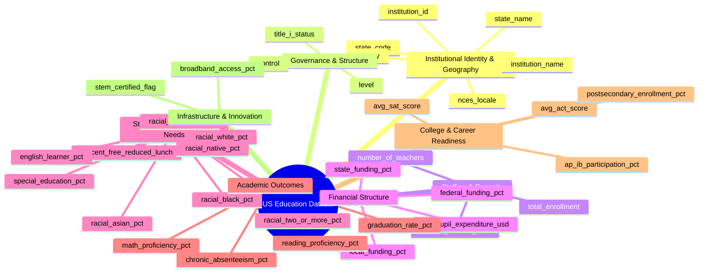

# 📖 U.S. Education System Dataset — Data Dictionary & Variable Codebook

[]()
[]()
[]()
[]()
[]()

---

> [!IMPORTANT]
> ### ⚠️ Mandatory Educational Disclaimer & Caveat
> **The dataset documented in this dictionary is synthetic / simulated data engineered strictly for educational, pedagogical, and coursework purposes within the AltSchool Africa 3rd Semester Machine Learning & Data Science curriculum.**  
> It **does not** represent empirical statistics, real-world census records, or actual reporting of the United States Department of Education, the National Center for Education Statistics (NCES), or any specific academic institution. Any resemblance to real institutions, living persons, or specific legal entities is purely coincidental.

---

## 📌 Executive Dataset Overview

| Metadata Attribute | Specification Details |
| :--- | :--- |
| **Dataset File Name** | `us_education_system_dataset.csv` |
| **Total Observations (Rows)** | `5,000` academic institutions |
| **Total Attributes (Columns)** | `35` features (1 Primary Identifier + 34 Predictive / Contextual features) |
| **Primary Key** | `institution_id` (Unique alphanumeric identifier) |
| **Data Types** | 6 Categorical / String, 2 Binary / Boolean, 27 Continuous / Discrete Numeric |
| **File Encoding / Format** | UTF-8 / Comma-Separated Values (`.csv`) |
| **Primary Use Cases** | Exploratory Data Analysis (EDA), Socioeconomic Disparity Modeling, Supervised Regression (Predicting Proficiency / Graduation Rates), Multiclass Classification, Clustering |

---

## 🗺️ High-Level Domain Taxonomies

The 35 features are partitioned into 8 functional domain modules:



---

## 📑 Complete Variable Catalog & Summary Table

| # | Column Name | Data Type | Measurement Scale | Missing (%) | Description |
| :-: | :--- | :---: | :---: | :-: | :--- |
| **1** | `institution_id` | String | Nominal (Key) | 0.00% | Unique standardized institutional code (`US-EDU-XXXXX`) |
| **2** | `institution_name` | String | Nominal | 0.00% | Human-readable name of the institution |
| **3** | `state_code` | String | Nominal | 0.00% | 2-letter postal code of the U.S. state / territory |
| **4** | `state_name` | String | Nominal | 0.00% | Full state name (50 States + District of Columbia) |
| **5** | `county` | String | Nominal | 0.00% | County administrative district where school resides |
| **6** | `nces_locale` | String | Nominal (8 Cat) | 0.00% | Urbanicity classification based on NCES locale framework |
| **7** | `level` | String | Nominal (6 Cat) | 0.00% | Grade band served (Elementary, Middle, High, College, etc.) |
| **8** | `control` | String | Nominal (5 Cat) | 0.00% | Governance / funding model (Public, Charter, Private, etc.) |
| **9** | `title_i_status` | String | Nominal (4 Cat) | 0.00% | Federal Title I Elementary & Secondary Education Act status |
| **10** | `total_enrollment` | Integer | Discrete Ratio | 0.00% | Total head count of enrolled students |
| **11** | `number_of_teachers` | Integer | Discrete Ratio | 0.00% | Total Full-Time Equivalent (FTE) teaching faculty |
| **12** | `student_teacher_ratio` | Float | Continuous Ratio | 0.00% | Ratio of enrolled students to teaching faculty |
| **13** | `percent_free_reduced_lunch` | Float | Continuous (0-100) | 0.00% | % of students qualifying for free/reduced-price lunch (FRPL) |
| **14** | `racial_white_pct` | Float | Continuous (0-100) | 0.00% | Percentage of student body identifying as White |
| **15** | `racial_black_pct` | Float | Continuous (0-100) | 0.00% | Percentage of student body identifying as Black / African American |
| **16** | `racial_hispanic_pct` | Float | Continuous (0-100) | 0.00% | Percentage of student body identifying as Hispanic / Latino |
| **17** | `racial_asian_pct` | Float | Continuous (0-100) | 0.00% | Percentage of student body identifying as Asian |
| **18** | `racial_native_pct` | Float | Continuous (0-100) | 0.00% | Percentage identifying as American Indian / Alaska Native |
| **19** | `racial_two_or_more_pct` | Float | Continuous (0-100) | 0.00% | Percentage identifying with two or more racial backgrounds |
| **20** | `special_education_pct` | Float | Continuous (0-100) | 0.00% | % receiving Special Education services (IEP / IDEA) |
| **21** | `english_learner_pct` | Float | Continuous (0-100) | 0.00% | % classified as English Language Learners (ELL) |
| **22** | `per_pupil_expenditure_usd` | Float | Continuous Ratio | 0.00% | Annual educational expenditure per enrolled pupil in USD |
| **23** | `federal_funding_pct` | Float | Continuous (0-100) | 0.00% | Proportion of operating budget sourced from federal revenue |
| **24** | `state_funding_pct` | Float | Continuous (0-100) | 0.00% | Proportion of operating budget sourced from state revenue |
| **25** | `local_funding_pct` | Float | Continuous (0-100) | 0.00% | Proportion of operating budget sourced from local revenue |
| **26** | `math_proficiency_pct` | Float | Continuous (0-100) | 0.00% | % of students meeting/exceeding state math standards |
| **27** | `reading_proficiency_pct` | Float | Continuous (0-100) | 0.00% | % of students meeting/exceeding state reading standards |
| **28** | `graduation_rate_pct` | Float | Continuous (0-100) | 0.00% | Cohort graduation rate percentage |
| **29** | `chronic_absenteeism_pct` | Float | Continuous (0-100) | 0.00% | % of students absent for 10% or more instructional days |
| **30** | `avg_sat_score` | Float | Discrete Interval | 67.50% | Mean SAT composite score (Range: 400 - 1600) |
| **31** | `avg_act_score` | Float | Continuous Interval | 67.50% | Mean ACT composite score (Range: 1 - 36) |
| **32** | `ap_ib_participation_pct` | Float | Continuous (0-100) | 71.58% | % of high school students participating in AP / IB courses |
| **33** | `postsecondary_enrollment_pct`| Float | Continuous (0-100) | 71.58% | % matriculating to 2-year or 4-year higher education within 16 mos |
| **34** | `stem_certified_flag` | String | Binary ('Yes'/'No') | 0.00% | Formal state/national STEM curriculum certification status |
| **35** | `broadband_access_pct` | Float | Continuous (0-100) | 0.00% | % of households with high-speed broadband in school catchment |

---

## 🔍 Detailed Variable Profiles

### Group 1: Institutional Identifiers & Geography

#### 1. `institution_id`
* **Domain Definition**: Unique alphanumeric primary key assigned to each school institution.
* **Storage Type**: `string` | **Statistical Scale**: Nominal (Unique ID)
* **Completeness**: 100% (5,000 / 5,000 non-null)
* **Value Format**: `US-EDU-XXXXX` (e.g., `US-EDU-10001` to `US-EDU-15000`)
* **ML Guidance**: **Drop prior to modeling**. High-cardinality non-predictive surrogate key. Retain only for audit tracking and record indexing.

#### 2. `institution_name`
* **Domain Definition**: Formal operating name of the school or academic academy.
* **Storage Type**: `string` | **Statistical Scale**: Nominal
* **Completeness**: 100% | **Unique Cardinality**: 780 distinct names
* **Top Frequencies**: *Roosevelt Elementary School* (32), *Centennial Grade School* (28), *Eisenhower Elementary School* (27).
* **ML Guidance**: Should not be used directly as a one-hot feature due to name recycling across distinct districts. Can be utilized for NLP token extraction (e.g., flagging `"Academy"`, `"Preparatory"`, `"Vocational"`).

#### 3. `state_code` & 4. `state_name`
* **Domain Definition**: Geographic location identifier of the school across the 50 U.S. states plus Washington D.C.
* **Storage Type**: `string` | **Statistical Scale**: Nominal (51 classes)
* **Completeness**: 100% | **Top States**: CA (531, 10.6%), TX (486, 9.7%), FL (348, 7.0%), NY (274, 5.5%), PA (184, 3.7%).
* **ML Guidance**: High collinearity between `state_code` and `state_name` (exact 1:1 mapping). Drop one column to prevent redundancy. Use Target Encoding or Frequency Encoding for tree models, or One-Hot Encoding for regularized linear regressions.

#### 5. `county`
* **Domain Definition**: County municipal boundary within the state.
* **Storage Type**: `string` | **Statistical Scale**: Nominal (104 unique counties)
* **Top Counties**: *Franklin County* (278), *Montgomery County* (266), *Marion County* (259).
* **ML Guidance**: County names can recur across different states (e.g., Franklin County exists in multiple states). If creating geographical embeddings, combine into a composite key: `state_code + "_" + county`.

#### 6. `nces_locale`
* **Domain Definition**: National Center for Education Statistics standard 12-grade urban-centric classification collapsed into 8 core geographic categories.
* **Storage Type**: `string` | **Statistical Scale**: Nominal / Categorical (8 classes)
* **Distribution**:
  - `Suburban - Large`: 1,496 (29.9%)
  - `City - Large`: 1,090 (21.8%)
  - `Suburban - Midsize`: 643 (12.9%)
  - `City - Midsize`: 541 (10.8%)
  - `Town - Fringe`: 395 (7.9%)
  - `Rural - Fringe`: 318 (6.4%)
  - `Rural - Remote`: 270 (5.4%)
  - `Town - Distant`: 247 (4.9%)
* **ML Guidance**: Essential predictor for analyzing resource access, connectivity, and urban-rural educational outcome splits. Ideal for One-Hot Encoding.

---

### Group 2: Governance, Level & Classification

#### 7. `level`
* **Domain Definition**: Instructional grade span served by the educational institution.
* **Storage Type**: `string` | **Statistical Scale**: Categorical (6 classes)
* **Distribution**:
  - `Elementary School`: 2,225 (44.5%)
  - `High School`: 1,209 (24.2%)
  - `Middle School`: 996 (19.9%)
  - `K-12 Combined`: 212 (4.2%)
  - `4-Year University`: 204 (4.1%)
  - `2-Year College`: 154 (3.1%)
* **ML Guidance**: Critical structural feature. As documented in Section 6, advanced secondary metrics (`avg_sat_score`, `ap_ib_participation_pct`) are conditional on `level`.

#### 8. `control`
* **Domain Definition**: Operational authority, governance structure, and legal funding classification.
* **Storage Type**: `string` | **Statistical Scale**: Categorical (5 classes)
* **Distribution**:
  - `Public`: 3,547 (70.9%)
  - `Public Charter`: 577 (11.5%)
  - `Private Non-Profit`: 499 (10.0%)
  - `Private Religious`: 256 (5.1%)
  - `Private For-Profit`: 121 (2.4%)
* **ML Guidance**: Highly interactive with financial features (`per_pupil_expenditure_usd` and `local_funding_pct`). Private schools exhibit distinct revenue and lunch assistance profiles.

#### 9. `title_i_status`
* **Domain Definition**: Institutional qualification under Title I, Part A of the Elementary and Secondary Education Act (ESEA) providing financial assistance to local educational agencies for children from low-income families.
* **Storage Type**: `string` | **Statistical Scale**: Categorical (4 classes)
* **Distribution**:
  - `Title I Schoolwide`: 2,180 (43.6%) — At least 40% low-income enrollment.
  - `Not Applicable`: 1,108 (22.2%) — Non-eligible levels (colleges/universities) or non-participating private entities.
  - `Title I Targeted`: 945 (18.9%) — Provides targeted assistance to specific at-risk students.
  - `Not Title I Eligible`: 767 (15.3%) — Does not meet poverty threshold.
* **ML Guidance**: Powerful proxy for institutional poverty density. Useful for stratified sampling and disparity benchmarking.

---

### Group 3: Staffing & Capacity Metrics

#### 10. `total_enrollment`
* **Domain Definition**: Total headcount of registered and attending students.
* **Storage Type**: `integer` | **Statistical Scale**: Ratio Numeric
* **Summary Statistics**:
  - **Min**: `80.0` | **Q1**: `438.0` | **Median**: `603.0` | **Mean**: `1,375.88` | **Q3**: `914.0` | **Max**: `45,252.0` | **Std**: `3,416.28`
* **ML Guidance**: Severe positive skewness driven by large postsecondary universities (max = 45,252). **Log-transformation (`np.log1p`) or RobustScaler recommended** prior to linear modeling or clustering.

#### 11. `number_of_teachers`
* **Domain Definition**: Total count of licensed Full-Time Equivalent (FTE) classroom teachers / instructional staff.
* **Storage Type**: `integer` | **Statistical Scale**: Ratio Numeric
* **Summary Statistics**:
  - **Min**: `5.0` | **Q1**: `29.0` | **Median**: `42.0` | **Mean**: `92.46` | **Q3**: `66.0` | **Max**: `3,279.0` | **Std**: `225.91`
* **ML Guidance**: Strongly correlated with `total_enrollment` ($r > 0.95$). Collinearity risk: avoid using both simultaneously in unpenalized OLS regressions without regularizing (Ridge/Lasso).

#### 12. `student_teacher_ratio`
* **Domain Definition**: Calculated metric representing the number of enrolled students per full-time instructional staff member ($\frac{\text{total\_enrollment}}{\text{number\_of\_teachers}}$).
* **Storage Type**: `float` | **Statistical Scale**: Ratio Numeric
* **Summary Statistics**:
  - **Min**: `6.0` | **Q1**: `12.6` | **Median**: `14.9` | **Mean**: `14.93` | **Q3**: `17.1` | **Max**: `30.0` | **Std**: `3.33`
* **ML Guidance**: Approximately normal bell-curve distribution. Preferred over raw enrollment/teacher counts for assessing classroom capacity.

---

### Group 4: Financial Structure & Expenditure

#### 22. `per_pupil_expenditure_usd`
* **Domain Definition**: Total annualized operating and capital expenditures divided by student headcount, in USD.
* **Storage Type**: `float` | **Statistical Scale**: Continuous Ratio (USD)
* **Summary Statistics**:
  - **Min**: `$7,500.00` | **Q1**: `$14,471.00` | **Median**: `$16,831.00` | **Mean**: `$17,113.41` | **Q3**: `$19,230.00` | **Max**: `$50,601.00` | **Std**: `$4,207.24`
* **ML Guidance**: Moderately right-skewed. Capstone feature for evaluating financial equity vs. student achievement.

#### 23. `federal_funding_pct`, 24. `state_funding_pct`, & 25. `local_funding_pct`
* **Domain Definition**: Proportional composition of institutional funding sources.
* **Storage Type**: `float` | **Statistical Scale**: Continuous Percentage ($[0, 100]$)
* **Summary Statistics**:
  - `federal_funding_pct`: Min: `0.0%`, Median: `13.2%`, Mean: `12.00%`, Max: `32.8%`, Std: `5.98`
  - `state_funding_pct`: Min: `2.0%`, Median: `43.1%`, Mean: `38.91%`, Max: `70.0%`, Std: `18.08`
  - `local_funding_pct`: Min: `10.3%`, Median: `42.7%`, Mean: `49.09%`, Max: `98.0%`, Std: `22.73`
* **Mathematical Integrity Constraint**:
  $$\text{federal\_funding\_pct} + \text{state\_funding\_pct} + \text{local\_funding\_pct} \equiv 100.0\%$$
* **ML Warning**: **Perfect Collinearity (Compositional Simplex Constraint)**. If including all three in linear or distance-based models, drop one variable to prevent matrix singularity ($X^T X$ non-invertibility).

---

### Group 5: Student Demographics & Socioeconomic Needs

#### 13. `percent_free_reduced_lunch`
* **Domain Definition**: Percentage of students eligible for the National School Lunch Program (FRPL) based on household federal poverty guidelines ($\le 185\%$ of FPL).
* **Storage Type**: `float` | **Statistical Scale**: Continuous Percentage ($[0, 100]$)
* **Summary Statistics**:
  - **Min**: `0.0%` | **Q1**: `21.7%` | **Median**: `42.4%` | **Mean**: `41.28%` | **Q3**: `59.5%` | **Max**: `98.0%` | **Std**: `24.09`
* **ML Guidance**: Premier indicator of student body socioeconomic status (SES). Exhibits strong inverse correlation with math and reading proficiency scores.

#### 14–19. Racial Composition Features
* **Features**: `racial_white_pct`, `racial_black_pct`, `racial_hispanic_pct`, `racial_asian_pct`, `racial_native_pct`, `racial_two_or_more_pct`
* **Storage Type**: `float` | **Statistical Scale**: Continuous Percentages ($[0, 100]$)
* **Summary Statistics**:
  - `racial_white_pct`: Min: `3.9%`, Median: `48.9%`, Mean: `48.08%`, Max: `92.1%`, Std: `19.63`
  - `racial_black_pct`: Min: `0.8%`, Median: `15.4%`, Mean: `17.42%`, Max: `67.3%`, Std: `11.81`
  - `racial_hispanic_pct`: Min: `1.5%`, Median: `19.9%`, Mean: `21.17%`, Max: `83.2%`, Std: `12.41`
  - `racial_asian_pct`: Min: `0.3%`, Median: `6.4%`, Mean: `7.75%`, Max: `36.0%`, Std: `6.02`
  - `racial_native_pct`: Min: `0.1%`, Median: `1.2%`, Mean: `1.44%`, Max: `9.6%`, Std: `1.34`
  - `racial_two_or_more_pct`: Min: `0.5%`, Median: `3.9%`, Mean: `4.13%`, Max: `25.4%`, Std: `2.11`
* **Mathematical Integrity Constraint**:
  $$\sum \text{racial\_*\_pct} \equiv 100.0\%$$
* **ML Guidance**: Simplex constraint applies. Diversity index (e.g., Simpson's Diversity Index or Shannon Entropy) can be engineered from these 6 components into a single scalar metric.

#### 20. `special_education_pct`
* **Domain Definition**: % of students receiving specialized academic services under Individuals with Disabilities Education Act (IDEA) or Individualized Education Programs (IEP).
* **Storage Type**: `float` | **Summary**: Min: `4.0%`, Median: `13.5%`, Mean: `13.46%`, Max: `25.0%`, Std: `3.49`

#### 21. `english_learner_pct`
* **Domain Definition**: % of students whose native language is not English and who require specialized English language acquisition support.
* **Storage Type**: `float` | **Summary**: Min: `0.0%`, Median: `11.1%`, Mean: `11.37%`, Max: `33.2%`, Std: `5.48`

---

### Group 6: Academic Achievement & Student Accountability

#### 26. `math_proficiency_pct`
* **Domain Definition**: Percentage of tested students meeting or exceeding grade-level state academic benchmarks in mathematics.
* **Storage Type**: `float` | **Statistical Scale**: Continuous Percentage ($[0, 100]$)
* **Summary Statistics**:
  - **Min**: `12.0%` | **Q1**: `48.2%` | **Median**: `60.1%` | **Mean**: `60.01%` | **Q3**: `71.8%` | **Max**: `96.0%` | **Std**: `16.54`
* **ML Guidance**: Primary continuous regression target variable for academic efficacy models.

#### 27. `reading_proficiency_pct`
* **Domain Definition**: Percentage of tested students meeting or exceeding grade-level state standards in English Language Arts / Reading comprehension.
* **Storage Type**: `float` | **Statistical Scale**: Continuous Percentage ($[0, 100]$)
* **Summary Statistics**:
  - **Min**: `15.0%` | **Q1**: `53.5%` | **Median**: `64.8%` | **Mean**: `64.84%` | **Q3**: `76.4%` | **Max**: `98.0%` | **Std**: `16.37`
* **ML Guidance**: High positive correlation with `math_proficiency_pct` ($r \approx 0.82$). Can be averaged with Math to construct a Composite Academic Proficiency Index.

#### 28. `graduation_rate_pct`
* **Domain Definition**: Adjusted 4-year cohort graduation rate representing the % of students earning a regular high school diploma within 4 years.
* **Storage Type**: `float` | **Summary**: Min: `60.0%`, Median: `85.0%`, Mean: `84.93%`, Max: `99.5%`, Std: `6.04`

#### 29. `chronic_absenteeism_pct`
* **Domain Definition**: Percentage of enrolled students missing 10% or more instructional days during the academic school year.
* **Storage Type**: `float` | **Summary**: Min: `4.0%`, Median: `20.0%`, Mean: `19.98%`, Max: `40.2%`, Std: `5.92`
* **ML Guidance**: Strong negative leading indicator for graduation rates and standardized test scores.

---

### Group 7: College & Career Readiness (Structural Missingness)

> [!NOTE]
> ### Structural Missingness Architecture
> Features in this section contain **Missing Not At Random (MNAR)** data by design. In real-world educational institutions, elementary and middle schools do not administer SAT/ACT exams, nor do they offer AP/IB coursework or record postsecondary college enrollment.

| Feature Name | Non-Null Count | Missing Count | Missing % | Available Institutional Levels |
| :--- | :---: | :---: | :---: | :--- |
| `avg_sat_score` | 1,625 | 3,375 | **67.50%** | High School (1,209), K-12 Combined (212), 4-Year University (204) |
| `avg_act_score` | 1,625 | 3,375 | **67.50%** | High School (1,209), K-12 Combined (212), 4-Year University (204) |
| `ap_ib_participation_pct` | 1,421 | 3,579 | **71.58%** | High School (1,209), K-12 Combined (212) |
| `postsecondary_enrollment_pct` | 1,421 | 3,579 | **71.58%** | High School (1,209), K-12 Combined (212) |

#### 30. `avg_sat_score`
* **Domain Definition**: Mean combined Evidence-Based Reading and Writing (ERW) and Math score on the College Board SAT.
* **Storage Type**: `float` | **Scale**: Discrete Interval ($[400, 1600]$)
* **Summary Statistics (Non-Null Population)**:
  - **Min**: `909.0` | **Q1**: `1,169.0` | **Median**: `1,236.0` | **Mean**: `1,232.92` | **Q3**: `1,296.0` | **Max**: `1,528.0` | **Std**: `91.95`

#### 31. `avg_act_score`
* **Domain Definition**: Mean composite score across English, Math, Reading, and Science sections on the ACT examination.
* **Storage Type**: `float` | **Scale**: Continuous Interval ($[1, 36]$)
* **Summary Statistics (Non-Null Population)**:
  - **Min**: `17.1` | **Q1**: `23.8` | **Median**: `25.5` | **Mean**: `25.52` | **Q3**: `27.3` | **Max**: `33.9` | **Std**: `2.40`
* **ML Guidance**: Collinear with `avg_sat_score` ($r > 0.90$).

#### 32. `ap_ib_participation_pct`
* **Domain Definition**: Percentage of 11th and 12th-grade students enrolled in at least one Advanced Placement (AP) or International Baccalaureate (IB) course.
* **Storage Type**: `float` | **Summary**: Min: `2.0%`, Median: `28.4%`, Mean: `28.42%`, Max: `56.4%`, Std: `7.74`

#### 33. `postsecondary_enrollment_pct`
* **Domain Definition**: Percentage of high school graduating cohort enrolled in postsecondary higher education within 16 months of graduation.
* **Storage Type**: `float` | **Summary**: Min: `37.7%`, Median: `66.6%`, Mean: `66.51%`, Max: `95.0%`, Std: `8.69`

---

### Group 8: Technology & Specialized Designations

#### 34. `stem_certified_flag`
* **Domain Definition**: Binary indicator designating whether the school holds formal accreditation for STEM (Science, Technology, Engineering, and Mathematics) curricula.
* **Storage Type**: `string` | **Statistical Scale**: Binary Nominal (`'Yes'` / `'No'`)
* **Distribution**:
  - `No`: 4,248 (85.0%)
  - `Yes`: 752 (15.0%)
* **ML Guidance**: Convert via binary mapping: `{'No': 0, 'Yes': 1}`. Useful feature for interaction with math proficiency and broadband access.

#### 35. `broadband_access_pct`
* **Domain Definition**: Percentage of residential households within the institution's municipal catchment area having active high-speed broadband internet subscriptions.
* **Storage Type**: `float` | **Statistical Scale**: Continuous Percentage ($[0, 100]$)
* **Summary Statistics**:
  - **Min**: `74.5%` | **Q1**: `87.5%` | **Median**: `90.8%` | **Mean**: `90.79%` | **Q3**: `94.2%` | **Max**: `99.0%` | **Std**: `4.59`
* **ML Guidance**: Infrastructure index; proxy for digital divide and homework connectivity equity.

---

## 🛠️ Data Preprocessing & Machine Learning Recommendations

### 1. Handling Missing Data (MNAR)
* **Do NOT blindly impute with mean or median** for `avg_sat_score`, `avg_act_score`, `ap_ib_participation_pct`, and `postsecondary_enrollment_pct`. Doing so imputes high school college readiness statistics into elementary and middle school records!
* **Recommended Strategies**:
  1. **Subset Modeling**: Train separate sub-models for High Schools & Secondary Institutions (`level in ['High School', 'K-12 Combined']`), where these features are 100% complete.
  2. **Missing Indicator + Imputation**: For global models, create a boolean missingness flag (`sat_missing_flag = 1`), then impute a neutral baseline (e.g., 0) to allow tree-based algorithms (XGBoost, LightGBM, CatBoost) to partition splits effectively.

### 2. Compositional Simplex Constraints (Collinearity Mitigation)
* **Funding Percentage Simplex**:
  $$\text{federal\_funding\_pct} + \text{state\_funding\_pct} + \text{local\_funding\_pct} = 100\%$$
* **Racial Composition Simplex**:
  $$\sum_{i=1}^6 \text{racial\_*\_pct}_i = 100\%$$
* **Action**: When utilizing regularized linear models (Ridge/Lasso), PCA, or ordinary least squares, drop one feature from each compositional group to avoid multicollinearity.

### 3. Outlier and Skew Handling
* Variables such as `total_enrollment` and `number_of_teachers` have extreme positive skews due to large universities. Apply log transformations:
  ```python
  import numpy as np
  df['log_total_enrollment'] = np.log1p(df['total_enrollment'])
  df['log_number_of_teachers'] = np.log1p(df['number_of_teachers'])
  ```

---

## 💻 Python Quick-Start Verification Script

```python
import pandas as pd
import numpy as np

# Load dataset
df = pd.read_csv('us_education_system_dataset.csv')

# Verify dimensions
print(f"Shape: {df.shape}")
assert df.shape == (5000, 35), "Dataset dimensions mismatch!"

# Verify compositional constraints
funding_sum = df[['federal_funding_pct', 'state_funding_pct', 'local_funding_pct']].sum(axis=1)
assert np.allclose(funding_sum, 100.0, atol=0.1), "Funding percentages must sum to 100%"

print("Data integrity check passed successfully!")
```

---

## 📄 License & Attribution

- **Curriculum**: AltSchool Africa — Data Science & Machine Learning (3rd Semester)
- **Author**: Emmanuel Bright Chetachi ([@Ecoplex82](https://github.com/Ecoplex82))
- **Year**: 2026
